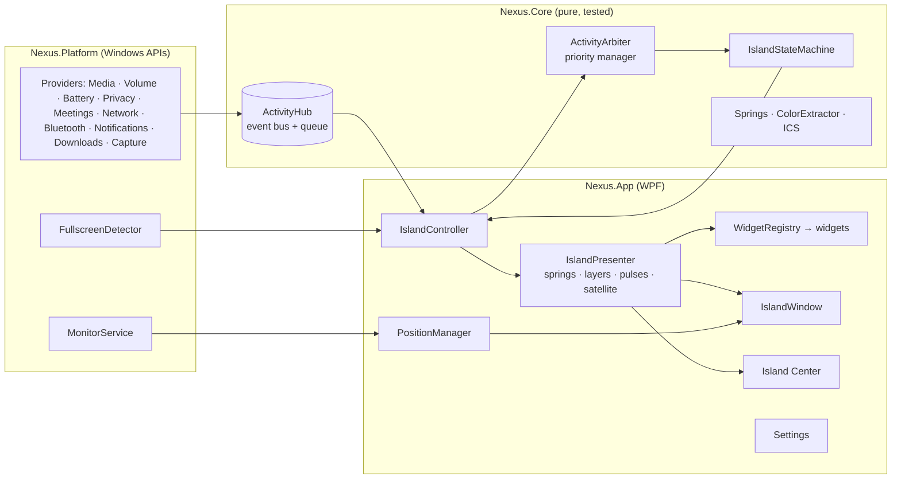

# NEXUS — Your Windows Activity Center

> *Invisible when nothing matters. Beautiful when something does. Powerful when you interact with it.*

NEXUS is an activity surface for the Windows desktop, inspired by Dynamic Island. It sits at the top of your screen as a small smoked-glass capsule. When something happens, it stretches, glows and morphs to show it, then settles back.

It is a native **.NET 8 / WPF** application that talks to Windows directly through Win32, COM and WinRT. There is no web view and no third-party runtime dependency.


---

## 1. Prerequisites

| Requirement | Version |
|---|---|
| Windows | Windows 11 (primary target). Windows 10 build 19041 or later also works; the Settings window uses a solid background there instead of Mica. |
| .NET SDK | 8.0.100 or newer (`winget install Microsoft.DotNet.SDK.8`) |
| IDE (optional) | Visual Studio 2022 17.8+ with the *.NET desktop development* workload, VS Code with C# Dev Kit, or Rider |

The app needs no NuGet packages; the WinRT APIs come from the `net8.0-windows10.0.19041.0` target framework. Only the test project restores xUnit.

## 2. Development environment

```
Nexus.sln
├─ src/Nexus.Core            net8.0           pure logic, no Windows dependency, unit-tested
├─ src/Nexus.Platform        net8.0-windows   Win32 / COM / WinRT interop + all system providers
├─ src/Nexus.App             net8.0-windows   WPF: island, rendering, widgets, Island Center, settings
├─ tests/Nexus.Core.Tests                     xUnit: arbiter, state machine, springs, colour, ICS
├─ samples/Nexus.Samples.HourlyChime          example third-party plugin
└─ .github/workflows/build.yml                CI: build + test + self-contained publish on windows-latest
```

## 3. Build

```powershell
dotnet build Nexus.sln -c Debug
dotnet test  tests/Nexus.Core.Tests
```

To build a self-contained version that runs without .NET installed:

```powershell
.\scripts\publish.ps1                    # → .\publish\win-x64\Nexus.exe
.\scripts\publish.ps1 -Runtime win-arm64
```

Push to GitHub and the included workflow builds, tests and uploads a ready-to-run `nexus-win-x64` artifact.

## 4. Run

```powershell
dotnet run --project src/Nexus.App                  # normal start
dotnet run --project src/Nexus.App -- --settings    # start and open Settings
```

- **First launch:** Settings opens and the island introduces itself.
- **Exit:** right-click the island or the tray icon, then choose **Exit NEXUS**.
- **Single instance:** launching NEXUS again opens the running instance's Settings instead of starting a second copy.
- **Try every state without waiting for real events:** open **Settings › Preview lab**. It plays simulated events and changes nothing on your system.

## 5. Debug

- Set **Nexus.App** as the startup project and press F5. UI exceptions are caught and logged so the overlay keeps running; turn on *break on thrown CLR exceptions* to catch them at the source.
- **Log file:** `%LOCALAPPDATA%\Nexus\logs\nexus.log`. It records component names, states and errors only — never track titles, notification text or meeting subjects. For verbose output, set `Log.MinimumLevel = LogLevel.Debug` in `App.OnStartup`.
- **Settings file:** `%LOCALAPPDATA%\Nexus\settings.json`. Out-of-range values are repaired on load. If the file is corrupt, it is backed up as `settings.json.corrupt` and NEXUS starts with defaults.
- **Provider health:** **Settings › Modules** shows each module's live status (Running, Unavailable or Error) and the reason.
- **Motion tuning:** all spring presets live in `Nexus.Core/Motion/Spring.cs` (`Morph`, `Content`, `Ambient`, `Micro`).

## 6. Implemented features (V1)

**Island and motion**
- **Overlay window**
  - Native transparent, topmost overlay that never takes focus.
  - Fully transparent pixels are click-through, so only the glass itself catches the mouse.
- **State model**
  - Idle → Peek (hover) → Compact → Expanded → Island Center, plus a critical-alert treatment.
- **Continuous morphing**
  - Width, height and corner radius are spring-driven, with a small controlled overshoot.
  - Motion is layered: the container moves first, content follows about 60 ms later, and Island Center sections stagger in last.
  - When content changes, the old content cross-fades out under the moving glass edge while the new content scales and slides in.
- **Efficiency**
  - A single frame clock runs only while something is moving. A settled island draws zero frames.
- **Accessibility**
  - Reduce-motion and animation-speed settings.
  - Each theme also has its own motion personality (Cyber is slightly snappier).

**Visual system**
- **Layered smoked glass**
  - Body gradient, frost diffusion, an atmosphere layer (Aurora), ambient light, a specular rim and an accent rim.
  - A soft shadow drawn only outside the body, so translucent glass is never darkened.
- **Ambient colour engine**
  - Takes the dominant hue from album art, then caps its saturation and brightness so it stays subtle.
  - Battery is green, amber or red; privacy is warm orange; meetings are indigo; Bluetooth and network are blue/cyan.
  - Low battery slowly shifts the idle island's glow toward amber.
- **Edge Pulse**
  - Rim bloom for Bluetooth, network, VPN, mic and notifications.
  - Energy sweep when the charger is connected.
  - Flash when a screenshot is taken.
- **Satellite capsule**
  - A detached mini-island next to the main one that holds ongoing background state: mic or camera in use, downloads, low battery, offline, or a call while music plays.
  - Hover to see labels; click to open Island Center.
- **Themes**
  - Obsidian (default), Fluent, Aurora, Cyber, Minimal and Custom.
  - Custom exposes transparency, frost, glow, corner roundness and accent behaviour, plus global scale, speed and idle style.
  - All themes share the same components.
- **Typography and icons**
  - Segoe UI Variable text, with fixed-width digits so timers and percentages never make the island jitter.
  - Segoe Fluent Icons, falling back to Segoe MDL2 Assets. No emoji.

**Priority and context**
- **Priority engine (Critical / High / Medium / Low)**
  - Critical always wins.
  - Short-lived events beat steady state: volume briefly covers music, then music returns without being rebuilt.
  - Whatever is currently shown stays put rather than flickering between activities.
  - Events of equal priority wait in a first-in, first-out queue, and each one's display time starts only when it is actually shown.
  - Low-value events that can't be shown within about 2 s are dropped.
  - Anything under the mouse pointer is never auto-dismissed.
- **Simultaneous activities:** one foreground activity plus up to four satellite indicators.
- **Fullscreen and gaming**
  - Detects exclusive fullscreen games, presentation mode and borderless fullscreen windows.
  - Behaviour is configurable: Gaming mode (critical and high-priority only), Critical only, Hide, or Always show.
  - Privacy indicators stay visible even in gaming mode.
- **Quiet mode (Do Not Disturb)**
  - Silences notifications, connectivity and transfer events.
  - Never silences critical alerts, privacy indicators or feedback to your own actions.

**Windows integrations** (all event-driven, no aggressive polling)

| Module | Windows source | Notes |
|---|---|---|
| Media | Windows media session API (the same source as the Windows media flyout) | Works with Spotify, Edge, Chrome, Firefox, YouTube Music, Media Player and others. Shows artwork, a seekable progress bar and previous/play/next. Paused media steps aside after 45 s. |
| Volume | Windows Core Audio change notifications | Shows mute, headphone and Bluetooth states and announces output-device switches. **Scroll over the island to change volume.** |
| Battery | `PowerManager` events + the battery report | Charging sweep, time-to-full and time-remaining. Low battery at 20%; critical alert at 7% with an Energy saver shortcut. |
| Mic / camera | The same registry store behind Windows' own privacy indicators, watched with `RegNotifyChangeKeyValue` | Shows the responsible app. The indicator stays while the device is in use. |
| Meetings | Mic usage by Teams, Zoom, Webex, Slack, Discord or Skype, plus an optional ICS calendar link | Call timer, mic and camera state, a system-wide mic mute, a "Meeting in N min" countdown and a "Starting now" card with Join. |
| Network / VPN | `NetworkStatusChanged` + `NetworkAddressChanged` | Wi-Fi name and signal, Ethernet, offline indicator, and VPN/tunnel adapters such as WireGuard, AnyConnect, GlobalProtect, Zscaler and Tailscale. |
| Bluetooth | `DeviceWatcher` (Classic + LE) | Connect/disconnect glances; audio devices get a headphones icon. |
| Notifications | `UserNotificationListener` | Requires a packaged (MSIX) build — see limitations. Compact sender-and-message view; expanded view with Dismiss. |
| Downloads | `FileSystemWatcher` on the Downloads folder | In-progress indicator, then a completion card with Open and Show in folder. |
| Screenshots | Clipboard listener + Screenshots folder | Flash confirmation, shown once even when both signals fire. |

**File Shelf**
- **Park files on the island:** drag files or folders from Explorer, the desktop or any app onto the island. It opens into a drop zone ("Drop to keep here") that says what you are adding, then a short glance confirms it and the satellite shows the count ("Shelf · 3 files").
- **Drag them out later:** Island Center's Shelf section lists every item with its Explorer thumbnail or icon. Drag one item, or "Drag all", into any app: a mail, a chat, an upload box, another folder. By default an item leaves the shelf once another app accepted it; a moved file always leaves.
- **Per item:** click or Enter opens, Show in folder, Copy path, Remove; Ctrl+C copies the file itself, so Ctrl+V pastes it in Explorer or a mail. "Drag all" clicked copies every file. "Clear" empties the shelf. Every row and button works from the keyboard.
- **Honest about what it keeps:** only paths are stored, never the files. Up to 24 items, newest first; dropping a path that is already there moves it to the top. Items whose original was moved or deleted show "Moved or deleted". Drags that carry no real file (a browser image, a mail attachment) are refused with a hint to save them first.
- **Settings:** Behavior › File Shelf (remember after restart, keep items after dragging them out, clear), Island Center (position or hide the section), Modules › File Shelf (switch the feature off entirely). Preview lab shows the drop zone and adds sample items that are never saved.

**App**
- **Island Center:** clock, privacy strip, now playing, file shelf, next meeting or call in progress, system tiles (audio, battery, network, Bluetooth), and quick actions (Quiet, Mic, Sound, Network, Bluetooth, Settings). Every section has an empty state.
- **Context menu:** drawn in the island's own glass, from both the island and the tray icon — Island Center, Quiet mode, Settings, Exit.
- **Settings app:** Mica background with native caption buttons on Windows 11. Pages: General, Appearance, Position & displays, Behavior, Modules, Privacy, Preview lab and About. Every change applies live.
- **Multi-monitor and DPI**
  - Per-monitor DPI aware, with placement in physical pixels.
  - Can follow the primary monitor, a specific monitor, or the monitor under your cursor.
  - Re-anchors when monitors are connected or removed, or when resolution or scaling changes.
- **Position:** top center, top left, top right, bottom center, or a custom horizontal position, each with a distance from the screen edge.
- **Start with Windows:** uses `HKCU\…\Run`. No admin rights and no scheduled tasks.
- **Resilience**
  - Each provider is isolated; one that fails is marked Error and the rest keep running.
  - Graceful fallbacks for: missing artwork, an app that exits mid-session, an unplugged monitor, an Explorer restart (the tray icon re-registers), no audio service, overly long text, missing icons, a broken plugin widget, and a corrupt settings file.

## 7. Known limitations

| Area | Limitation | What NEXUS does instead |
|---|---|---|
| Backdrop blur | Windows has no supported API to blur behind an animated, irregularly shaped, transparent overlay window. The undocumented blur API blurs the whole rectangular window; system backdrops need a normal window with fixed corners. | Layered glass (frost, gradients, ambient light) tuned to stay readable on light and dark wallpapers. The Settings window uses real Mica. |
| Notifications | Windows only lets apps with package identity (MSIX or a sparse package) read other apps' notifications, and only after you consent. Unpackaged runs (`dotnet run`) can't. | The module shows *Unavailable* with the reason. NEXUS's own events still use the notification layout. To enable it, package with MSIX, declare `<uap3:Capability Name="userNotificationListener"/>`, then allow access in Settings › Privacy & security › Notifications. |
| Incoming calls | Teams, Zoom and similar apps expose no public local API for a ringing call. | A call appears as soon as the app takes the microphone. In a packaged build, ringing toasts also arrive through notifications. |
| Teams mute | Teams' in-app mute button has no public local API. | "Mute mic" mutes the **Windows** microphone, which silences every app — the safer privacy behaviour anyway. |
| Calendar | V1 deliberately has no Microsoft Graph sign-in (no accounts, no tokens). | Optional ICS link (Outlook can publish one). Daily and weekly repeats are fully supported (interval, count, until, weekdays, exceptions). For monthly and yearly repeats, only the first occurrence is shown. |
| Download progress | Browsers don't expose a download's total size to other apps. | An indeterminate "downloading" indicator plus a completion card. |
| Mic / camera | Only apps running under your user account are visible; system services are recorded elsewhere. | — |
| Wi-Fi name | Newer Windows builds may hide the network name from apps without location permission. | The tile shows "Connected" without a name. |
| Equalizer | Decorative. A real per-app spectrum would require hooking audio capture. | Capped at 24 FPS, stops when hidden, and can be turned off in Appearance. |
| File Shelf and admin apps | Windows blocks drag-and-drop from an app running as administrator to a normal one (UIPI). NEXUS never sees such a drag, so it cannot explain it. | Files can't be dragged from apps running as administrator onto NEXUS. Drag from a normal Explorer window instead, or run that app normally. |
| File Shelf and virtual files | Browser images, Outlook attachments and similar drags have no file on disk, only data the target app would have to save. | The drop zone refuses them and says to save them as files first. |
| Edge clicks | A layered window catches clicks on any pixel that isn't fully transparent. | The soft shadow is only a few pixels wide and very faint, so clicks right at the island's edge may land on NEXUS. |

## 8. Architecture



| Concept from the brief | Implementation |
|---|---|
| EventBus / EventQueue | `Core/Activities/ActivityHub.cs` — thread-safe, merges bursts of changes into one update, and tracks when each item was posted, queued and shown. |
| PriorityManager | `Core/Scheduling/ActivityArbiter.cs` — a pure function of the current activities and policy (fullscreen, quiet mode, disabled modules). |
| StateManager | `Core/State/IslandStateMachine.cs` — explicit modes plus user intent; time is passed in, so it is fully deterministic and testable. |
| AnimationEngine | `Core/Motion/Spring.cs` (spring maths) and `App/Motion/Animator.cs` (on-demand frame clock, `Spring`, `ColorSpring`). |
| ThemeEngine | `App/Theming` — themes are data; every component reads the resolved `Palette`. |
| Rendering | `App/Rendering/IslandSurface.cs` — every glass layer and effect, drawn in one `OnRender`. |
| PluginManager | `App/Composition/ProviderManager.cs` — provider lifecycle, failure isolation, module toggles and plugin loading. |
| IslandWindow / PositionManager | `App/Island` — Win32 window styles; monitor, DPI and anchor placement. |
| Composition root | `App/Composition/NexusHost.cs` — the only place services are created. |

**How an event flows:** a provider receives a Windows event (on any thread) and posts an immutable `Activity` → the hub merges bursts onto the UI thread → the controller asks the arbiter what should dominate under the current policy → the state machine combines that with what the user is doing (hover, click, Island Center) → the presenter retargets its springs and updates or swaps the widget → the frame clock runs until everything settles, then stops. Re-checks are scheduled only for the exact moment something expires; otherwise NEXUS sleeps.

## 9. Creating a new provider

A provider detects events, creates and updates activities, assigns a priority, supplies content and actions, and removes activities when they end.

```csharp
public sealed class DockerProvider : ProviderBase
{
    public override string Id => "docker";
    public override string DisplayName => "Docker";
    public override string Description => "Container builds and crashes.";

    protected override Task OnStartAsync(CancellationToken ct)
    {
        // Subscribe to your event source here. Prefer events over polling.
        return Task.CompletedTask;
    }

    private void OnBuildProgress(string image, double progress) => Post(new Activity
    {
        Id = "docker.build." + image,            // stable id → posting again updates in place
        SourceId = Id,
        Priority = ActivityPriority.Low,
        Category = ActivityCategory.Transfer,     // quiet mode and gaming mode understand categories
        CanBeForeground = false,                  // only a satellite indicator while running
        Content = new GenericContent(Glyphs.Download, $"Building {image}", null, progress),
        Indicator = new IndicatorSpec(Glyphs.Download, NexusColor.FromHex("#2496ED"), $"{image} {progress:P0}", progress),
    });

    private void OnContainerCrashed(string name)
    {
        Pulse(new PulseSignal(SemanticColors.Critical));
        Post(new Activity
        {
            Id = "docker.crash." + name, SourceId = Id,
            Priority = ActivityPriority.High, Category = ActivityCategory.System,
            Duration = TimeSpan.FromSeconds(8),   // short-lived: queued, shown, then removed
            Content = new GenericContent(Glyphs.Warning, $"{name} exited", "Exit code 137"),
            Actions = new[] { new ActivityAction("logs", "View logs", Glyphs.Open, () => Task.CompletedTask, IsPrimary: true) },
        });
    }
}
```

- **Built in:** register the provider in `NexusHost.RegisterProviders`. It appears in **Settings › Modules** automatically.
- **As a plugin:** build a class library that references `Nexus.Core` (see `samples/Nexus.Samples.HourlyChime`), copy the DLL into `%LOCALAPPDATA%\Nexus\plugins`, enable **Settings › General › Load plugins**, and restart NEXUS.
- **Rules of thumb:**
  - Choose the lowest priority that is honest.
  - Set `Duration` for news; leave it null for ongoing state.
  - Use `IsDormant` for state that only Island Center needs.
  - Use `CanBeForeground = false` plus an `Indicator` for background state.
  - Pulse for minor events rather than expanding the island.

## 10. Creating a new widget

Plugins rarely need one: `GenericContent` and `GlanceContent` are rendered by the built-in widgets. For a custom presentation:

```csharp
public sealed record PomodoroContent(TimeSpan Remaining, bool Break);

public sealed class PomodoroWidget : Widget<PomodoroContent>
{
    protected override IWidgetView CreateCompact(TrackedActivity a, WidgetContext ctx) => new View(ctx, a);
    protected override IWidgetView CreateExpanded(TrackedActivity a, WidgetContext ctx) => new View(ctx, a);

    private sealed class View : WidgetView<PomodoroContent>
    {
        private readonly Grid _root;
        private readonly TextBlock _time;

        public View(WidgetContext ctx, TrackedActivity a) : base(ctx, a)
        {
            _time = Kit.Numeric("", Kit.Type.BodyStrong, P.TextPrimary, FontWeights.SemiBold);
            _root = Kit.Columns(
                (Kit.Glyph(Glyphs.Clock, 15, ctx.AccentBrushOf(a.Activity)).WithMargin(14, 0, 10, 0), Kit.Auto),
                (_time.WithMargin(0, 0, 16, 0), Kit.Star));
            _root.Height = Layout.CompactHeight;
            Apply((PomodoroContent)a.Activity.Content);
        }

        public override FrameworkElement Element => _root;
        protected override void Apply(PomodoroContent c) => _time.Text = Kit.FormatTime(c.Remaining);
    }
}
```

Register the widget in `NexusHost.BuildWidgets()`; later registrations take precedence. Rules:
- Create views once and update them in place through `Apply`.
- The island sizes itself from the content, so keep the height fixed per mode and cap text widths.
- Start timers in `OnShown` and stop them in `OnHidden`.
- Build with `Kit`, `NexusButton`, `ProgressTrack` and `Palette` so every theme works automatically.

## 11. Privacy and security

- No telemetry, no accounts, and no network requests except the ICS link you choose to add.
- Runs without admin rights. No code injected into other processes, no keyboard hooks, no drivers.
- Settings stay in `%LOCALAPPDATA%\Nexus`. Notification and meeting content is held in memory only, never written to disk.
- The File Shelf saves only the paths of shelved files, in `%LOCALAPPDATA%\Nexus\shelf.json`, and only while *Remember shelf after restart* is on (turning it off deletes the file). The log records item counts, never file names or paths.
- Screen-sharing switches let you hide notification previews and meeting titles.

---

### Build status

NEXUS builds cleanly in Debug and Release (`dotnet build Nexus.sln`), all unit tests pass (`dotnet test tests/Nexus.Core.Tests`), and it runs daily on Windows 11. The included GitHub workflow builds, tests and publishes a self-contained `win-x64` build on every push.
