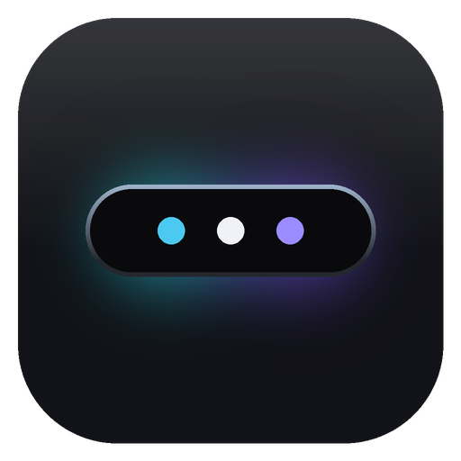
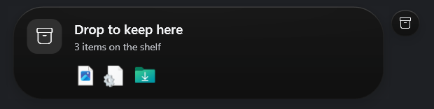
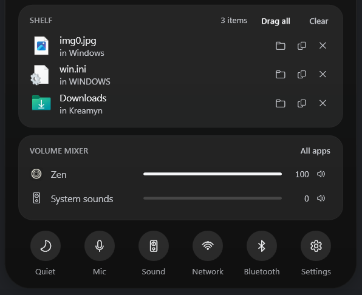
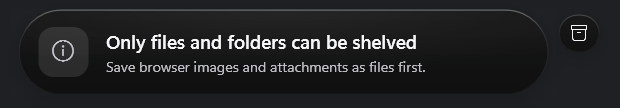
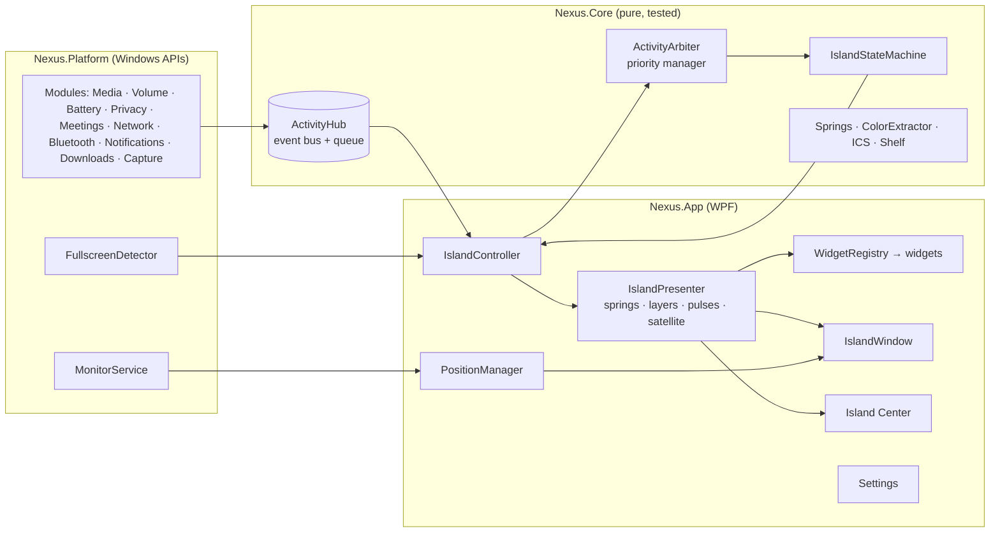

<p align="center">
  
</p>

<h1 align="center">NEXUS</h1>

<p align="center">
  A Dynamic Island for Windows.<br>
  A small glass capsule at the top of your screen that shows what your PC is doing, then gets out of the way.
</p>

<p align="center">
  <a href="https://github.com/Kareemsss/nexus-windows/actions/workflows/build.yml"></a>
</p>

<p align="center">
  
</p>

When music starts, the volume changes, your battery runs low or an app turns on your microphone, the island stretches open to show it, then shrinks back to a small pill. Click it and it unfolds into **Island Center**, a compact dashboard for the things you check all day.

NEXUS is a native Windows app built with .NET 8 and WPF. It talks to Windows directly, so there is no web view and nothing extra to install.

---

## What it shows

| | |
|---|---|
| **Music and video** | What is playing in Spotify, your browser, YouTube Music, Media Player and other apps, with artwork, a seek bar and play controls. |
| **Volume** | The level, mute, headphones and Bluetooth audio, and a note when the output device changes. Scroll over the island to change the volume. |
| **Battery** | Charging, time left and time to full. A warning at 20%, and an alert at 7% with a shortcut to Energy saver. |
| **Microphone and camera** | Which app is using them, for as long as it does. Taken from the same place as Windows' own privacy icons. |
| **Meetings** | A call timer when Teams, Zoom, Webex, Slack, Discord or Skype uses your mic, one button to mute the mic, and a countdown to your next meeting if you add a calendar link. |
| **Network** | Wi-Fi name and signal, Ethernet, going offline, and VPNs such as WireGuard, AnyConnect, GlobalProtect, Zscaler and Tailscale. |
| **Bluetooth** | Devices connecting and disconnecting. |
| **Downloads** | A small indicator while a browser download runs, then a card with Open and Show in folder. |
| **Screenshots** | A quick flash when you take one. |
| **Notifications** | Other apps' notifications, in packaged (MSIX) builds only. See [Known limitations](#known-limitations). |
| **File Shelf** | Files you dropped on the island, ready to drag into any app. [More below](#file-shelf). |

Things that stay true for a while, like your mic being on or a download running, sit in a small second capsule beside the island instead of taking it over.

## Using it

| Do this | What happens |
|---|---|
| Hover over the island | It shows the time, date, Wi-Fi and battery. |
| Click it | It expands what it is showing. Click again to open Island Center. |
| Scroll over it | The system volume goes up or down. |
| Right-click it | A menu with Island Center, Quiet mode, Settings and Exit. |
| Drag files onto it | They go on the [File Shelf](#file-shelf). |
| Click the small capsule beside it | Island Center opens. |
| Press Esc or click somewhere else | Island Center closes. |

The tray icon works too: left-click opens Island Center, right-click opens the menu.

**Important things stay in front.** A critical battery alert always wins. Quick events like a volume change cover your music for a moment, then the music comes back. Nothing disappears while your pointer is on it.

**Games and full-screen apps** get Gaming mode by default: only critical alerts and important events such as a meeting starting can appear. You can also choose Critical only, Hide, or Always show. Privacy indicators stay visible in every mode.

**Quiet mode** silences notifications, network and download events. Critical alerts, privacy indicators and responses to what you do yourself still appear.

**Hide completely** keeps the island off screen all the time. Push the pointer against the top edge to slide it out (Reveal at screen edge is on by default). Critical alerts still slide out on their own.

## File Shelf

Drag any file or folder onto the island and it stays there. Later, drag it out into an email, a chat, an upload box or another folder. No more juggling two Explorer windows.

<p align="center">
  
</p>

- The island opens into a drop zone as soon as files reach it, and tells you what you are adding.
- Island Center lists everything on the shelf with its icon. Click an item to open it, or use the buttons to show it in its folder, copy its path or remove it.
- Drag one item out, or use **Drag all**. Clicking Drag all copies every file instead, ready to paste. **Clear** empties the shelf.
- Once another app accepts an item, it leaves the shelf. You can keep items instead in Settings › Behavior.
- Everything works from the keyboard: Tab moves between items, Enter opens, Delete removes, Ctrl+C copies the file and Ctrl+Shift+C copies its path.

The shelf only remembers where your files are. It never copies or reads them. It holds up to 24 items, and dropping something that is already there moves it to the top. If you move or delete the original, the item says **Moved or deleted**.

Browser images and mail attachments are not files yet, so the island says so instead of taking them:

<p align="center">
  
</p>

## Island Center

Click the island once more after it expands, or click it while it is idle, and it unfolds into Island Center: the clock, which apps are using your mic or camera, what is playing, the File Shelf, a per-app volume mixer, your next meeting or the call you are in, status tiles for audio, battery, network and Bluetooth, and quick buttons for Quiet mode, mic mute, sound, network, Bluetooth and settings.

You choose which sections appear and in what order, which tiles and buttons you see, and whether empty sections hide themselves (Settings › Island Center).

## Install

There is no release yet. You can download the latest build or build it yourself.

**Download the latest build** (needs a GitHub account):

1. Open the [Actions tab](https://github.com/Kareemsss/nexus-windows/actions/workflows/build.yml) and click the newest run with a green check.
2. Under **Artifacts**, download **nexus-win-x64**. GitHub keeps these downloads for 90 days.
3. Unzip it anywhere, for example `%LOCALAPPDATA%\Programs\NEXUS`, and run `Nexus.exe`. It includes everything it needs, so you don't have to install .NET.

**Requirements:** Windows 11. Windows 10 (build 19041 or later) also works, with a plain Settings background instead of Mica.

On the first start, Settings opens and the island introduces itself. To start NEXUS with Windows, turn on Settings › General › Start with Windows. It needs no admin rights. To quit, right-click the island or the tray icon and choose **Exit NEXUS**.

**Try everything without waiting:** Settings › Preview lab plays sample events (music, a low battery, a meeting, the File Shelf and more) without changing anything on your PC.

## Make it yours

The Settings app applies every change as you make it.

- **Appearance:** six themes (Obsidian, Fluent, Aurora, Cyber, Minimal and Custom). Custom lets you set transparency, frost, glow, corner roundness and accent colour behaviour. Also island size, animation speed, Reduce motion, Eco mode and the idle style (capsule, line or dot).
- **Position & displays:** top center, top left, top right, bottom center or a custom spot, at any distance from the edge. Show it on your main display, a specific one, or whichever display your pointer is on.
- **Behavior:** what hover and click do, scroll for volume, Quiet mode, Hide completely, song pop-ups, full-screen behaviour and File Shelf options.
- **Modules:** switch any module off. Each one shows whether it is running and, if not, why.
- **Privacy:** what NEXUS reads and what it stores, plus switches that hide notification previews and meeting titles while you share your screen.

## Privacy

- No telemetry, no account, and no network requests except the calendar link you choose to add.
- No admin rights, no keyboard hooks, no drivers, and no code injected into other apps.
- Settings live in `%LOCALAPPDATA%\Nexus`. Notification text and meeting titles stay in memory and are never written to disk.
- The File Shelf saves only file paths, in `%LOCALAPPDATA%\Nexus\shelf.json`, and only while *Remember shelf after restart* is on. Turning it off deletes the file.
- The log records which parts of NEXUS ran and any errors. It never records song titles, notification text, meeting subjects, file names or paths.

## Known limitations

| Area | Why | What NEXUS does |
|---|---|---|
| Blur behind the glass | Windows has no supported way to blur behind an animated, irregular, transparent window. | Layered glass tuned to stay readable on light and dark wallpapers. The Settings window uses real Mica. |
| Notifications | Windows only lets packaged apps (MSIX) read other apps' notifications, and only after you allow it. | The module shows *Unavailable* with the reason. To enable it, package NEXUS as MSIX with the `userNotificationListener` capability, then allow it in Windows Settings › Privacy & security › Notifications. |
| Incoming calls | Teams, Zoom and similar apps have no public way to report a ringing call. | A call appears as soon as the app takes the microphone. Packaged builds also see ringing notifications. |
| Teams mute button | Teams has no public way to control its own mute. | Mute mic mutes the Windows microphone, which silences every app. |
| Calendar | NEXUS has no Microsoft account sign-in by design. | Add an ICS link (Outlook can publish one). Daily and weekly repeats work fully. For monthly and yearly repeats, only the first one shows. |
| Download progress | Browsers don't tell other apps how big a download is. | A "downloading" indicator, then a completion card. |
| Mic and camera | Only apps running under your account are visible. | |
| Wi-Fi name | Newer Windows builds may hide the network name from apps without location permission. | The tile says Connected without a name. |
| Equalizer bars | They are decoration. A real spectrum would mean capturing your audio. | Capped at 24 frames a second, paused when hidden, and can be turned off. |
| Clicks at the very edge | Windows sends clicks on any pixel that is not fully transparent to the window. | The shadow is only a few pixels wide and very faint, so a click right at the edge may land on NEXUS. |
| File Shelf and admin apps | Windows blocks dragging from an app running as administrator to a normal app. | Drag from a normal Explorer window, or run the other app normally. |

---

## For developers

**You need:** the .NET 8 SDK or newer (`winget install Microsoft.DotNet.SDK.8`), and optionally Visual Studio 2022 17.8+ with *.NET desktop development*, VS Code with C# Dev Kit, or Rider. The app uses no NuGet packages. Only the test project pulls in xUnit.

```
Nexus.sln
├─ src/Nexus.Core            net8.0           logic with no Windows dependency, unit-tested
├─ src/Nexus.Platform        net8.0-windows   Win32, COM and WinRT interop, and every system module
├─ src/Nexus.App             net8.0-windows   WPF: the island, rendering, widgets, Island Center, settings
├─ tests/Nexus.Core.Tests                     xUnit tests
├─ samples/Nexus.Samples.HourlyChime          an example plugin
└─ .github/workflows/build.yml                builds, tests and publishes on every push
```

**Build, test and run:**

```powershell
dotnet build Nexus.sln -c Debug
dotnet test tests/Nexus.Core.Tests
dotnet run --project src/Nexus.App                  # start NEXUS
dotnet run --project src/Nexus.App -- --settings    # start NEXUS and open Settings
```

**Publish a version that runs without .NET installed:**

```powershell
.\scripts\publish.ps1                      # creates .\publish\win-x64\Nexus.exe
.\scripts\publish.ps1 -Runtime win-arm64
```

Only one copy runs at a time. Starting NEXUS again opens the running copy's Settings.

<details>
<summary><b>Debugging</b></summary>

- Set **Nexus.App** as the startup project and press F5. Errors in the UI are caught and logged so the island keeps running. Turn on *break when CLR exceptions are thrown* to stop where they happen.
- The log is at `%LOCALAPPDATA%\Nexus\logs\nexus.log`. For more detail, set `Log.MinimumLevel = LogLevel.Debug` in `App.OnStartup`.
- Settings are at `%LOCALAPPDATA%\Nexus\settings.json`. Out-of-range values are repaired when NEXUS loads them. A file it can't read is kept as `settings.json.corrupt`, and NEXUS starts with defaults.
- Settings › Modules shows each module as Running, Unavailable or Error, with the reason.
- All animation spring presets live in `Nexus.Core/Motion/Spring.cs` (`Morph`, `Content`, `Ambient`, `Micro`).

</details>

<details>
<summary><b>How it works</b></summary>



A module receives a Windows event (on any thread) and posts an immutable `Activity`. The hub merges bursts and hands them to the UI thread. The controller asks the arbiter what should be in front under the current rules (full screen, Quiet mode, disabled modules), and the state machine combines that with what you are doing (hovering, clicking, Island Center open, dragging files). The presenter then retargets its springs and updates or swaps the widget. The frame clock runs only until everything settles, and NEXUS wakes up again only at the exact moment something expires.

| Part | Where |
|---|---|
| Event bus and queue | `Core/Activities/ActivityHub.cs` |
| Priority rules | `Core/Scheduling/ActivityArbiter.cs` |
| Island states (Idle, Peek, Compact, Expanded, Center, Drop) | `Core/State/IslandStateMachine.cs` |
| Animation | `Core/Motion/Spring.cs` and `App/Motion/Animator.cs` |
| Themes | `App/Theming` |
| Glass rendering | `App/Rendering/IslandSurface.cs` |
| Module lifecycle and plugins | `App/Composition/ProviderManager.cs` |
| Window and placement | `App/Island` |
| File Shelf | `Core/Shelf`, `App/Shelf`, `App/Center/ShelfCard.cs`, `App/Widgets/DropZoneView.cs` |
| Where everything is created | `App/Composition/NexusHost.cs` |

</details>

<details>
<summary><b>Writing a module (provider)</b></summary>

A provider listens to one source, turns events into activities with a priority, content and actions, and removes them when they end.

```csharp
public sealed class DockerProvider : ProviderBase
{
    public override string Id => "docker";
    public override string DisplayName => "Docker";
    public override string Description => "Container builds and crashes.";

    protected override Task OnStartAsync(CancellationToken ct)
    {
        // Subscribe to your event source here. Prefer events over polling.
        return Task.CompletedTask;
    }

    private void OnBuildProgress(string image, double progress) => Post(new Activity
    {
        Id = "docker.build." + image,            // a stable id: posting again updates it in place
        SourceId = Id,
        Priority = ActivityPriority.Low,
        Category = ActivityCategory.Transfer,     // Quiet mode and Gaming mode understand categories
        CanBeForeground = false,                  // only a small indicator beside the island while it runs
        Content = new GenericContent(Glyphs.Download, $"Building {image}", null, progress),
        Indicator = new IndicatorSpec(Glyphs.Download, NexusColor.FromHex("#2496ED"), $"{image} {progress:P0}", progress),
    });

    private void OnContainerCrashed(string name)
    {
        Pulse(new PulseSignal(SemanticColors.Critical));
        Post(new Activity
        {
            Id = "docker.crash." + name, SourceId = Id,
            Priority = ActivityPriority.High, Category = ActivityCategory.System,
            Duration = TimeSpan.FromSeconds(8),   // short-lived: queued, shown, then removed
            Content = new GenericContent(Glyphs.Warning, $"{name} exited", "Exit code 137"),
            Actions = new[] { new ActivityAction("logs", "View logs", Glyphs.Open, () => Task.CompletedTask, IsPrimary: true) },
        });
    }
}
```

- **Built in:** register it in `NexusHost.RegisterProviders`. It shows up in Settings › Modules on its own.
- **As a plugin:** build a class library that references `Nexus.Core` (see `samples/Nexus.Samples.HourlyChime`), copy the DLL into `%LOCALAPPDATA%\Nexus\plugins`, turn on Settings › General › Load plugins, and restart NEXUS.
- Choose the lowest priority that is honest. Set `Duration` for news and leave it empty for ongoing state. Use `IsDormant` for state only Island Center needs, `CanBeForeground = false` with an `Indicator` for background state, and a pulse instead of expanding the island for small events.

</details>

<details>
<summary><b>Writing a widget</b></summary>

Plugins rarely need one, because `GenericContent` and `GlanceContent` already have built-in widgets. For a custom look:

```csharp
public sealed record PomodoroContent(TimeSpan Remaining, bool Break);

public sealed class PomodoroWidget : Widget<PomodoroContent>
{
    protected override IWidgetView CreateCompact(TrackedActivity a, WidgetContext ctx) => new View(ctx, a);
    protected override IWidgetView CreateExpanded(TrackedActivity a, WidgetContext ctx) => new View(ctx, a);

    private sealed class View : WidgetView<PomodoroContent>
    {
        private readonly Grid _root;
        private readonly TextBlock _time;

        public View(WidgetContext ctx, TrackedActivity a) : base(ctx, a)
        {
            _time = Kit.Numeric("", Kit.Type.BodyStrong, P.TextPrimary, FontWeights.SemiBold);
            _root = Kit.Columns(
                (Kit.Glyph(Glyphs.Clock, 15, ctx.AccentBrushOf(a.Activity)).WithMargin(14, 0, 10, 0), Kit.Auto),
                (_time.WithMargin(0, 0, 16, 0), Kit.Star));
            _root.Height = Layout.CompactHeight;
            Apply((PomodoroContent)a.Activity.Content);
        }

        public override FrameworkElement Element => _root;
        protected override void Apply(PomodoroContent c) => _time.Text = Kit.FormatTime(c.Remaining);
    }
}
```

Register it in `NexusHost.BuildWidgets()`. Later registrations win. Create views once and update them in place through `Apply`, keep the height fixed for each mode, start timers in `OnShown` and stop them in `OnHidden`, and build with `Kit`, `NexusButton`, `ProgressTrack` and `Palette` so every theme works.

</details>

## Project status

NEXUS builds cleanly in Debug and Release, all unit tests pass, and it runs daily on Windows 11. Every push is built, tested and published by the GitHub workflow.

No license has been chosen yet, so all rights are reserved by the author.
