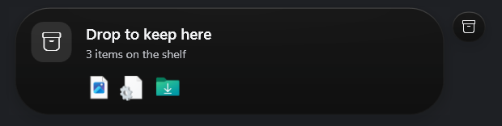

The first public release of NEXUS: a Dynamic Island for Windows. A small glass capsule sits at the top of your screen, opens up to show what your PC is doing, then shrinks back out of the way.

## Install

1. Download **NEXUS-Setup-1.0.0.exe** from the Assets below.
2. Run it. It installs for your Windows account only, so it needs no administrator rights. You can choose to start NEXUS when you sign in and to add a desktop shortcut.
3. NEXUS starts when setup finishes, and Settings opens so you can look around. **Settings › Preview lab** plays sample events if you want to see everything right away.

**Windows may warn you.** The installer is not code-signed yet, so SmartScreen can show "Windows protected your PC". Click **More info**, then **Run anyway**.

**Requirements:** Windows 11, or Windows 10 build 19041 or later. Everything NEXUS needs is included, so you don't have to install .NET.

## What it shows

- **Music and video** from Spotify, browsers, YouTube Music, Media Player and others, with artwork and play controls.
- **Volume**, mute, headphones and Bluetooth audio. Scroll over the island to change the volume.
- **Battery**: charging, time left, a warning at 20% and an alert at 7%.
- **Microphone and camera**: which app is using them, for as long as it does.
- **Meetings** in Teams, Zoom, Webex, Slack, Discord and Skype, with a call timer and one-click mic mute.
- **Network**, VPNs, **Bluetooth** devices, **downloads** and **screenshots**.
- **File Shelf**: drag files onto the island to keep them, then drag them out of Island Center into any app.

Click the island to open **Island Center**: the clock, now playing, the File Shelf, a per-app volume mixer, your next meeting, status tiles and quick buttons. Six themes, Quiet mode, Gaming mode for full-screen apps, and a Hide completely mode are in Settings.

## Good to know

- **Updating:** run a newer installer. It closes NEXUS, updates it, starts it again and keeps your settings and File Shelf.
- **Uninstalling:** Windows Settings › Apps › Installed apps › NEXUS. You choose whether to keep your settings or move them to the Recycle Bin.
- **Privacy:** no telemetry, no account, and no network access except a calendar link you add yourself. Settings stay in `%LOCALAPPDATA%\Nexus`.
- **Notifications from other apps** only work in a packaged (MSIX) build, which this installer is not. Windows grants that access only to packaged apps. Everything else works.

The full list of features and known limitations is in the [README](https://github.com/Kareemsss/nexus-windows#readme).
